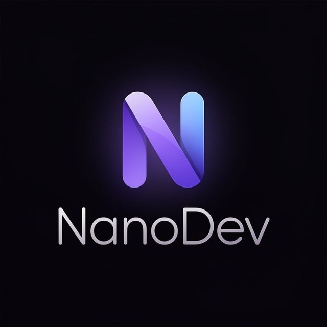
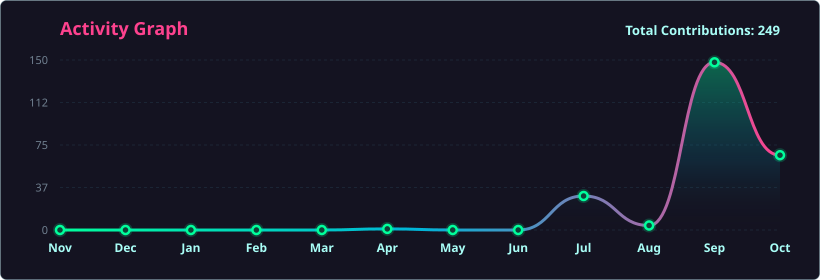

  

  

✧･ﾟ: *✧･ﾟ:* 　　*:･ﾟ✧*:･ﾟ✧

  ➳ 💻 <b>Обычный программист-разработчик</b> • Системный и прикладной софт 
  ➳ 🛠️ <b>Стек:</b> C++ • Rust • C • Java • Kotlin • C# 
  ➳ 🔧 Сейчас пилю для <a href="https://github.com/nanodev1488/NanoDecompiler"><b>ɴᴀɴᴏᴅᴇᴄᴏᴍᴘɪʟᴇʀ</b></a> новую версию V2.0 
  ➳ 📡 Веду телеграм-канал: <a href="https://t.me/nanodev_MC">t.me/nanodev_MC</a> &bull; Личка: <a href="https://t.me/radoqi">@radoqi</a> 
  ➳ ⚡ Люблю низкоуровневый код, скорость и свои пет-проекты :)

  
  
  
  
  

  
  
  
  
  
  

─── ✦ ───

## 📊 ᴄᴛᴀᴛиᴄᴛиᴋᴀ

  
  

## 🏆 ᴛᴩоɸᴇи

  

## 📈 ᴦᴩᴀɸиᴋ ᴀᴋᴛиʙноᴄᴛи

  

## 🐍 ᴄᴏɴᴛʀɪʙᴜᴛɪᴏɴ sɴᴀᴋᴇ

  

## 💬 циᴛᴀᴛᴀ дня

<!--QUOTE-START-->
> Nothing important is learned; it is simply remembered.
>
> — Carlos Ruiz Zafon
<!--QUOTE-END-->

## 📌 ᴨᴩо ɴᴀɴᴏᴅᴇᴄᴏᴍᴘɪʟᴇʀ

<!--PROJECT-STATUS-START-->
- ⭐ Звёзды: **6**
- 🈺 Основной язык: **C++**
- 📝 Последний коммит: _docs: update PROJECT_STATE with ItemsAdder 3.2M LOC audit results_
- 🕒 Обновлено: 2026-10-16 10:26 UTC
<!--PROJECT-STATUS-END-->

## 📡 ᴨоᴄᴧᴇдниᴇ ᴨоᴄᴛы ʙ ᴋᴀнᴀᴧᴇ

<!--TG-FEED-START-->
- [Кстати я ещё апдейты завёз. Можете скачать: github.com/NanoDev1488/NanoForge/releases Там ещё я готовлю математическое обновление, более 1к строк прав…](https://t.me/NanoDev_mc/410)
- [https://t.me/rubup?startapp=r_6486689289_390467 Крутаните по ссылке плиззз](https://t.me/NanoDev_mc/408)
- [github.com/NanoDev1488/NanoRp-creator/ Чекайте чо начал делать ❤️](https://t.me/NanoDev_mc/407)
<!--TG-FEED-END-->

─── ✦ ───

˜”*°•.•°*”˜ ✦ ˜”*°•.•°*”˜

